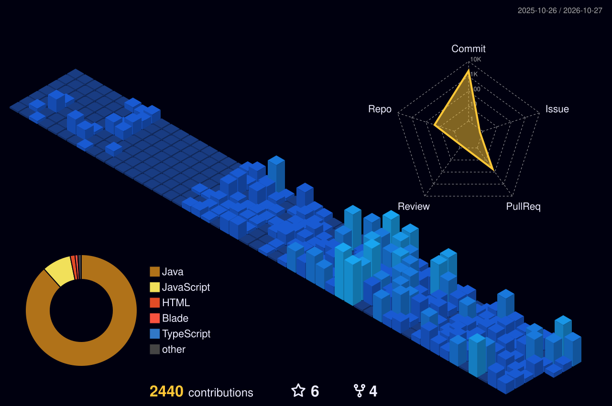

<!-- 🔥 Animated Typing Introduction -->

  

<!-- 🏡 Coding From Home Picture At Top -->

  

<h1 align="center">Hi , I'm Piyush Kumar</h1>
<h3 align="center">Backend Developer | BTech CSE @ LPU | Problem Solver</h3>

<!-- 🌐 Quick Connect Badges -->

  
  
  
  
  

  

---

<!-- 👨‍💻 ABOUT ME WITH ANIMATED HEADING & NEON CODING SETUP -->
## 👨‍💻  About Me

<table>
  <tr>
    <td width="60%" valign="top">
      

        Hey there! I'm <strong>Piyush Kumar</strong>, a Computer Science undergraduate at <strong>Lovely Professional University</strong> (2023–2027) with a strong foundation in backend architecture, distributed systems, and real-world full-stack development.
      

      <ul>
        <li>🎓 <strong>Education:</strong> BTech in CSE, Lovely Professional University (<strong>CGPA: 8.13</strong>)</li>
        <li>💻 <strong>Backend Focus:</strong> High-throughput Node.js & Express systems, RESTful API design, JWT authentication, and asynchronous worker queues.</li>
        <li>🧠 <strong>AI & Systems:</strong> Retrieval-Augmented Generation (<strong>RAG</strong>) with vector embeddings (PostgreSQL + <code>pgvector</code>), Redis caching, and BullMQ task queues.</li>
        <li>⚡ <strong>Problem Solving:</strong> <strong>600+ LeetCode problems</strong> solved (200-Day Streak Badge 🏅) and <strong>5⭐ in Java</strong> on HackerRank.</li>
        <li>📫 <strong>Get in Touch:</strong> <a href="mailto:piyushkk0206@gmail.com">piyushkk0206@gmail.com</a> | <code>+91-9798526058</code></li>
        <li>💬 <strong>Philosophy:</strong> <em>"I enjoy breaking systems... just to re-engineer them faster and stronger."</em> 😄</li>
      </ul>
    </td>
    <td width="40%" align="center" valign="middle">
      
    </td>
  </tr>
</table>

---

<!-- 🔭 CURRENTLY WORKING ON -->
## 🔭  Currently Working On
- 🚀 **RecallAI:** AI-powered Knowledge Management & RAG Platform with vector search and asynchronous task processing  
- 💼 **Karobaar:** Full-stack POS & Business Management platform with offline billing and financial analytics  
- ⚡ **Scalable Node.js & Express systems** and advanced DSA problem-solving  

---

<!-- 🛠️ COLORFUL TECH STACK & TOOLBOX -->
## 🛠️  Tech Stack & Toolbox: `</>`

  

### 💻 Programming Languages

  
  
  
  
  
  
  

### ⚙️ Backend & Architecture

  
  
  
  
  
  
  

### 🎨 Frontend Development

  
  
  
  

### 🗄️ Databases & Vector Storage

  
  
  
  
  

### 🛠️ DevOps & Tools

  
  
  
  
  
  
  
  

### 🧠 Core Computer Science

  
  
  
  
  

---

<!-- 🚀 FEATURED PROJECTS -->
## 🚀  Featured Projects

###  RecallAI — AI-Powered Knowledge Management & RAG Platform

  
  

> 🧠 *Enterprise AI knowledge engine enabling users to upload, query, and synthesize multi-source documents using local embeddings, vector retrieval, and LLM orchestration.*

- ⚡ **Semantic RAG Pipeline:** Built end-to-end extraction, recursive text chunking, local 384-dimensional embeddings, and top-5 semantic retrieval with PostgreSQL + `pgvector`.
- 🛡️ **Rate-Limit Resilience:** Token-aware batching and controlled concurrency managing TPM/RPM constraints across Groq and Gemini to eliminate API throttling.
- 📦 **Asynchronous Processing:** Decoupled heavy document workloads using **Redis & BullMQ**, separating API and worker queues for scalable ingestion.

  
  
  
  
  
  
  
  

  

---

###  Karobaar — Business Management & POS Platform

  
  

> 💼 *Full-featured POS and commerce platform supporting role-based access, offline pause billing, FIFO inventory management, and automated WhatsApp payment reminders.*

- 💳 **POS Engine & Billing:** RBAC and JWT authentication with refresh tokens, tax/discount calculation, instant PDF invoice generation, and offline Pause billing via IndexedDB.
- 📦 **Inventory & Ledger:** FIFO batch tracking, product variants, and purchase orders alongside a customer Khata ledger for credit tracking with automated WhatsApp payment alerts.
- 📊 **Financial Analytics & AI:** Cash flow forecasting, Excel export generation, and integrated Google Gemini API for natural-language business query assistance.

  
  
  
  
  
  
  
  

  

---

###  Anarchy Bay — Digital Marketplace Platform

  
  

> 🛒 *Full-stack digital marketplace featuring Supabase authentication, product management, and containerized deployment with Docker and GitHub Actions.*

- 🤝 **Full-Stack Architecture:** Developed in a 3-member team with secure authentication, multi-vendor resource catalog, and frictionless checkout flows.
- 🎨 **Responsive UI/UX:** Built Landing, Browse, Product Details, Help Center, and Contact modules using React & Tailwind CSS.
- 🔄 **DevOps Automation:** Automated build and deployment pipelines via Docker and GitHub Actions with dynamic search and category filtering.

  
  
  
  
  
  
  

  

---

###  NexaMart — B2B & B2C Marketing Platform

  
  

> 🏪 *Multi-vendor commercial platform supporting seller registration, real-time stock control, dynamic image previews, and admin approval workflows.*

- 🛍️ **Dual Market Engine:** Integrated B2B and B2C workflows with seller dashboards and real-time inventory adjustments.
- ⚡ **Dynamic DOM Previews:** Client-side image preview engine and responsive multi-screen layout.
- 🛡️ **Admin Workflow:** Multi-tier verification pipeline for seller credentials and product approval.

  
  
  
  
  

  

---

<!-- 🎧 CODING SOUNDTRACK & SPOTIFY VIBE -->
## 🎧  Coding Soundtrack & Spotify Vibe

  <!-- Exact Animated Spotify Player Card -->
  

    

  

    
    
    
  

---

<!-- ⚔️ LEETCODE ARENA & SUBMISSION HEATMAP -->
## ⚔️  LeetCode Arena & Submission Heatmap

  
  
  

<!-- ⚡ Dynamic LeetCode Heatmap & Performance Card (Real Data) -->

  

---

<!-- 📊 GITHUB STATS (REAL LIVE DATA) -->
## 📊  GitHub Analytics

  

  

  

---

<!-- 🧱 GITHUB 3D CONTRIBUTION GRAPH -->
## 🧱  GitHub 3D Contribution Graph

  

---

<!-- 🎮 PAC-MAN CONTRIBUTION HEATMAP -->
## 🎮  Pac-Man Contribution Heatmap

  <picture>
    <source media="(prefers-color-scheme: dark)" srcset="https://raw.githubusercontent.com/Piyush5621/Piyush5621/pacman-output/pacman-contribution-graph-dark.svg">
    <source media="(prefers-color-scheme: light)" srcset="https://raw.githubusercontent.com/Piyush5621/Piyush5621/pacman-output/pacman-contribution-graph.svg">
    
  </picture>

---

<!-- 🏆 CERTIFICATIONS & ACHIEVEMENTS -->
## 🏆  Certifications & Achievements

### 📜 Certifications
- 🔹 **Build Generative AI Apps and Solutions** — *Infosys Springboard* (Sep 2025)  
- 🔹 **Industry-Oriented DSA Backend Development Program** — *CipherSchools* (Jul 2025)  
- 🔹 **Cloud Computing** — *NPTEL* (Apr 2025)  

### 🌟 Milestones
- 🏅 **600+ LeetCode Problems Solved:** Earned the prestigious **200-Day Streak Badge** through consistent problem solving.  
- ⭐ **5-Star Java Rating:** Achieved 5-star golden badge on **HackerRank**.  
- 🎓 **Academic Excellence:** 8.13 CGPA in BTech CSE at Lovely Professional University.  

---

<!-- 🌐 CONNECT WITH ME -->
## 🌐  Connect With Me

  
  
  

---

  <!-- Real Live Profile Views Counter -->
  

    
  

  <!-- Animated 3D Fluent Stickers -->
  

    
    &nbsp;&nbsp;
    
    &nbsp;&nbsp;
    
  

  <!-- Dynamic Animated Typing Footer Message -->
  

    
  

  

    <em>⚡ Let's connect and build something impactful together! ⚡</em>
  

  <!-- Animated Gradient Wave Footer -->
  

